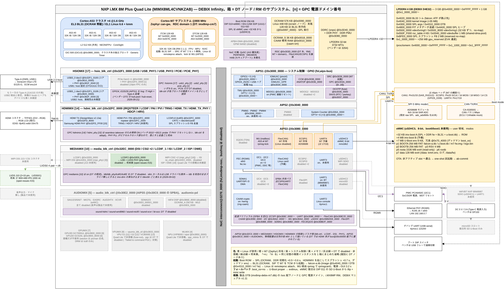

# DEBIX Infinity (i.MX8MP) bring up 記録

Polyhex **DEBIX Infinity**(NXP i.MX 8M Plus Quad Lite、EMB-IMX8MP-06-D4E32)への製品移行の記録。
形式は [../imx8mm-xpi-bringup/](../imx8mm-xpi-bringup/) に倣う。全体像は [../../README.ja.md](../../README.ja.md)。
ビルド・書き込み・更新などの操作の手順は [../usage/](../usage/README.md) にまとめてある。

## ハード構成図

SoC 内部(A53 / M7 / メモリ / NoC / HSIOMIX・HDMIMIX・MEDIAMIX・AUDIOMIX・GPU・VPU・NPU / AIPS1〜5 配下のペリフェラル、
GPC 電源ドメイン番号)と外部(LPDDR4・eMMC のメモリマップ、J2、ADS8688・CAN、HDMI→TFP401、LVDS J10(将来案)、USB、PMIC)の対応。
箱 = DT ノードまたは RM のサブシステム、色 = Linux 使用 / M7 所有 / disabled / 将来案。根拠は製品 DTB(imx8mp-debix-m7.dtb)、
i.MX8MP RM Rev.3、DEBIX マニュアル v1.11。編集は [hardware.drawio](hardware.drawio)(draw.io)。

## このディレクトリの構成

| ファイル | 内容 |
|---|---|
| [00-plan.md](00-plan.md) | ブリングアップ計画とボード要点(XPI との差分) |
| [01-m7.md](01-m7.md) | Cortex-M7 の起動とプログラムロード、rpmsg/MU、FlexCAN1 所有の確定 |
| [02-dts-delta.md](02-dts-delta.md) | DEBIX 実機用 DTS 差分(工場 5.10 DTS vs 6.6 EVK DTB) |
| [03-first-boot.md](03-first-boot.md) | 初回ブート: ブートローダ(DDR/HDMI/USB)の修正と切り分け |
| [04-falcon.md](04-falcon.md) | Falcon mode 移植(SPL 直カーネル起動、DRAM バンク、ロードアドレス) |
| [06-splash.md](06-splash.md) | SPL スプラッシュと seamless takeover、暗ブートの真因と修正 |
| [07-emmc-boot-rom.md](07-emmc-boot-rom.md) | eMMC ブートと BootROM の仕様調査(boot0 / user 領域、fast boot の採否) |
| [08-dark-boot.md](08-dark-boot.md) | 暗ブート調査の経緯と結論 |
| [30-boot-time.md](30-boot-time.md) | 起動時間の短縮記録(電源→GUI 3.2s までの内訳) |
| [fastboot-runbook.md](fastboot-runbook.md) | eMMC fast boot 工事ランブック |
| [open-issues.md](open-issues.md) | 未解決事項と暫定対応(将来案を含む。LVDS 化は #15) |
| [hardware.drawio](hardware.drawio) / [hardware.png](hardware.png) | ハード構成図(SoC 内部ブロックと外部機器、メモリマップ。draw.io 原本と書き出し PNG) |
